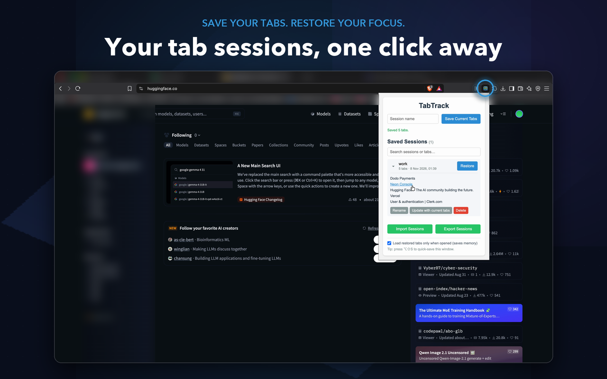

# TabTrack — Tab Session Manager

A Manifest V3 Chrome extension to save, organise and restore browser tab sessions,
with tab-group support, lazy loading and crash recovery.



<!-- TODO: add Chrome Web Store link -->

## Features

- **Save** the current window as a named session, newest first.
- **Restore** a session in a new window, including **pinned tabs** and **tab groups**
  (names, colours, collapsed state).
- **Lazy restore**: only the first tab loads; the rest load when you click them,
  so restoring 50 tabs doesn't freeze the browser.
- **Crash recovery**: open windows are auto-saved every few minutes. After a restart,
  TabTrack offers to restore the previous browser session.
- **Quick-save shortcut**: `Alt+Shift+S` saves the current window instantly.
- **Manage sessions**: expand to view tabs, open a single tab, rename, update with
  current tabs, delete (with confirmation) and search by name, title or URL.
- **Import / export** as JSON, with schema validation, duplicate detection and
  http(s)-only URL filtering.
- **Private by design**: everything stays in local storage. See the [privacy policy](privacy-policy.md).

## Install for development

```bash
git clone https://github.com/it-is-Aman/TabTrack-extension.git
cd TabTrack-extension
npm install
```

1. Open `chrome://extensions` and enable **Developer mode**.
2. Click **Load unpacked** and select the `src/` folder.

## Scripts

| Command            | Description                                    |
|--------------------|------------------------------------------------|
| `npm test`         | Run the unit tests (Vitest)                    |
| `npm run coverage` | Run tests with a coverage report               |
| `npm run lint`     | Lint with ESLint                               |
| `npm run build`    | Package `src/` into `dist/tabtrack-<version>.zip` for the Web Store |

CI (GitHub Actions) runs lint, tests and the build on every push and pull request,
and uploads the packaged zip as an artifact.

## Project structure

```
src/
├── manifest.json
├── background.js        # Service worker: messages, auto-save, shortcut, migrations
├── popup/
│   ├── popup.html
│   ├── popup.css
│   └── popup.js         # UI only; delegates window work to the service worker
└── lib/
    ├── constants.js     # Shared constants and storage keys
    ├── sessions.js      # Pure logic: validation, import merge, migration, search
    ├── storage.js       # chrome.storage.local wrapper
    ├── tabs.js          # Capture/restore windows, tab groups, lazy discard
    ├── urls.js          # Restorable-URL check
    ├── errors.js
    └── format.js
tests/                   # Vitest unit tests with an in-memory chrome.* mock
scripts/build.js         # Packaging script
```

## Architecture notes

**Why restore runs in the service worker.** Restoring focuses a new window, which
closes the popup and stops its scripts. The popup therefore sends a message
(`RESTORE_SESSION`) to the service worker, which outlives the popup and finishes
the job.

**Tab groups across browser restarts.** Chrome's group ids are only valid for the
current browser session, so groups are saved with small local ids that tabs refer
to. On restore, real groups are recreated with `chrome.tabs.group` and styled with
`chrome.tabGroups.update`.

**Lazy restore.** Discarding a tab before its URL commits loses the URL, so each
background tab is discarded only after `chrome.tabs.onUpdated` reports a committed
URL (with a timeout fallback that leaves the tab loaded).

**Auto-save.** A periodic `chrome.alarms` alarm plus a debounced alarm on tab
changes snapshot all normal, non-incognito windows. On `runtime.onStartup` the last
snapshot becomes the recovery offer. Empty snapshots never overwrite useful ones.

**Untrusted input.** Imported files are parsed and rebuilt field by field:
unknown properties are dropped, only `http`/`https` URLs are kept, group colours
are checked against Chrome's allowed values, and duplicates are skipped.

**Storage schema versioning.** A `schemaVersion` key lets `onInstalled` migrate
existing users' data on update (for example, v1 → v2 added session ids and
newest-first ordering).

### Data model

```jsonc
{
  "id": "uuid",
  "name": "Research",
  "timestamp": "2026-11-08T10:00:00.000Z",
  "updatedAt": "2026-11-09T09:00:00.000Z",  // optional
  "tabs": [
    { "url": "https://a.com", "title": "A", "pinned": true },
    { "url": "https://b.com", "title": "B", "groupId": 0 }
  ],
  "groups": [{ "id": 0, "title": "Docs", "color": "blue", "collapsed": false }]
}
```

## Changelog

See [CHANGELOG.md](CHANGELOG.md).

## Roadmap

- Optional cloud sync between devices
- Firefox and Edge support

## Contributing

Contributions are welcome! Fork the repository, create a branch, and open a pull
request. Please run `npm run lint` and `npm test` before submitting.

## License

[MIT](LICENSE) © 2025 Aman Rajput
